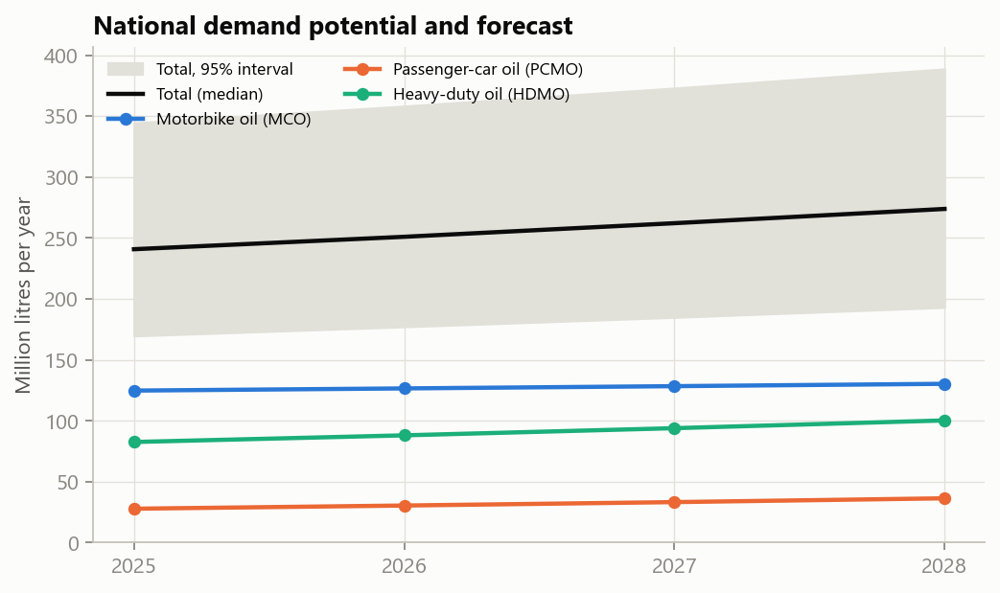
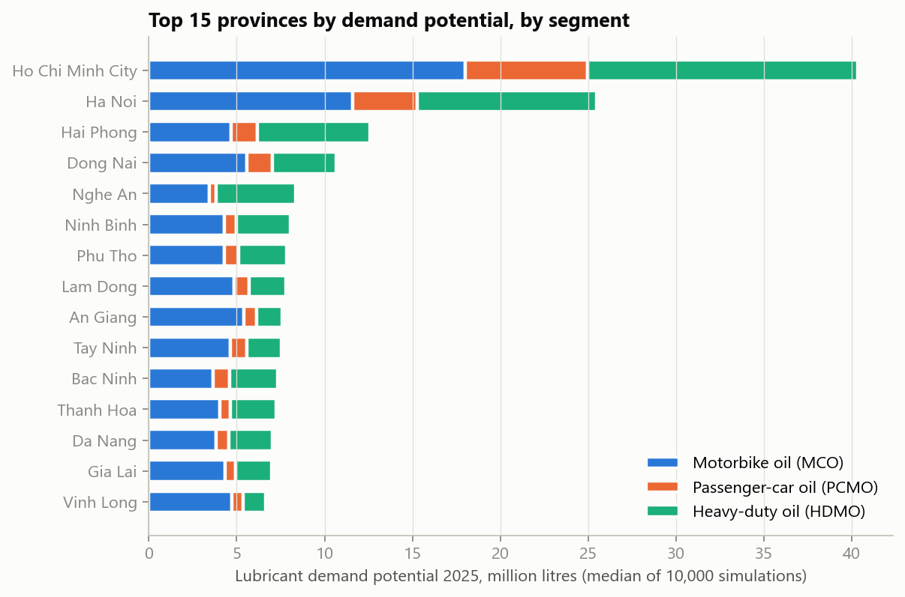
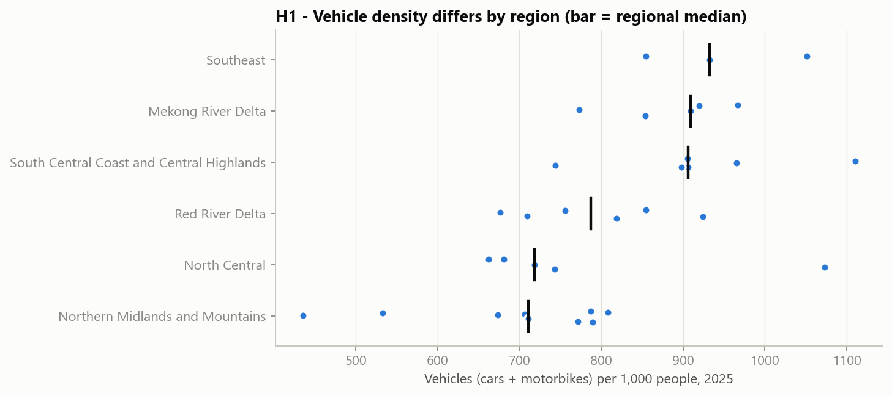
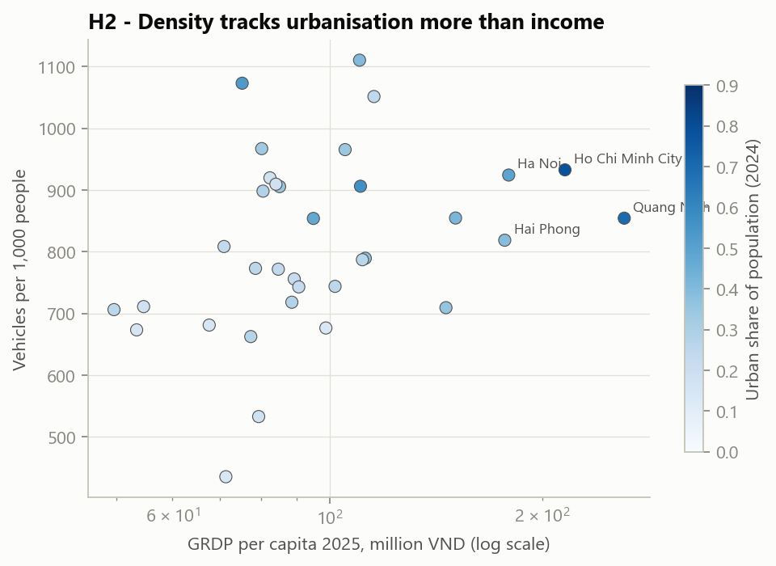
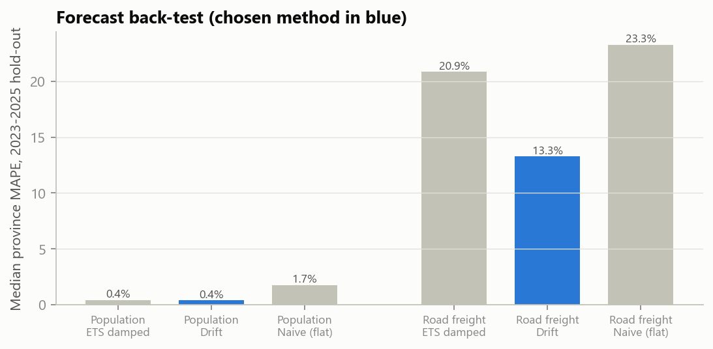
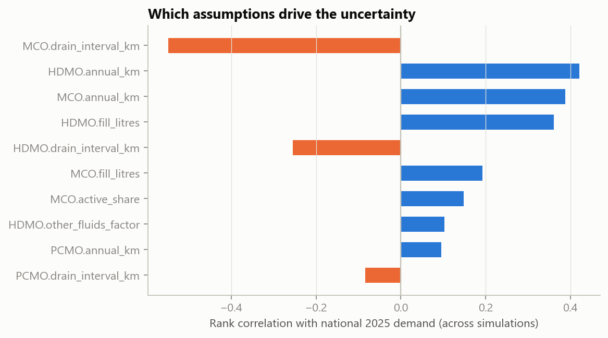
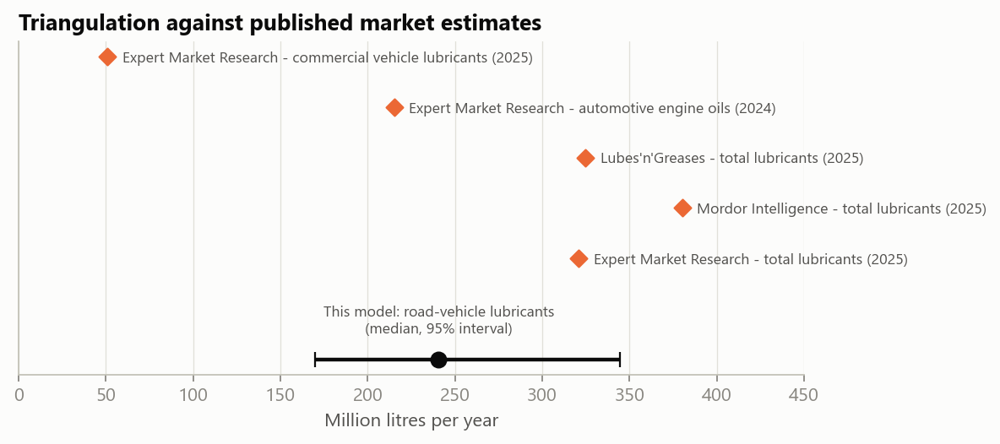

# Findings - Vietnam lubricant demand potential

_Generated 2026-11-24 12:23 by `python -m vnlube.pipeline`. Every number below is recomputed from the official NSO data on each run._

## Headline

- **240.7 million litres** of road-vehicle lubricant demand potential in 2025 (95% interval 169.6-344.3 M L, 10,000 Monte Carlo draws).
- Split: motorbike oil 124.8 M L, passenger-car oil 27.9 M L, heavy-duty oil 82.6 M L.
- Forecast 2028: **273.8 M L** (CAGR 4.4%). Fastest-growing segment: passenger-car oil (+31%, 27.9 -> 36.4 M L); largest absolute gain: heavy-duty oil (+17.7 M L).
- Triangulation: published estimates put automotive engine oils at 215 M L (2024, Expert Market Research) and all lubricants (incl. industrial) at 321-380 M L; the model's road-vehicle estimate sits between the two, as it should.

## Priority provinces (tier A)

Score = 60% size of the 2025 market + 40% absolute growth to 2028 (percentile ranks, computed in every simulation). *P(top 10)* = share of simulations in which the province ranks in the top 10.

| Rank | Province | Region | 2025 M L | +M L to 2028 | CAGR | Growth focus | P(top 10) |
|---:|---|---|---:|---:|---:|---|---:|
| 1 | Ho Chi Minh City | Southeast | 40.8 | 6.8 | 5.3% | HDMO | 100% |
| 2 | Ha Noi | Red River Delta | 25.7 | 4.1 | 5.0% | HDMO | 100% |
| 3 | Hai Phong | Red River Delta | 12.7 | 2.4 | 5.9% | HDMO | 100% |
| 4 | Dong Nai | Southeast | 10.8 | 1.3 | 4.0% | HDMO | 100% |
| 5 | Nghe An | North Central | 8.4 | 1.7 | 6.4% | HDMO | 97% |
| 6 | Ninh Binh | Red River Delta | 8.1 | 1.0 | 4.2% | HDMO | 100% |
| 7 | Lam Dong | South Central Coast and Central Highlands | 7.8 | 1.0 | 4.0% | HDMO | 97% |
| 8 | Phu Tho | Northern Midlands and Mountains | 7.9 | 0.8 | 3.5% | HDMO | 99% |
| 9 | Bac Ninh | Red River Delta | 7.4 | 1.2 | 5.2% | HDMO | 92% |
| 10 | Thanh Hoa | North Central | 7.3 | 0.9 | 4.1% | HDMO | 37% |

Robust picks (in the top 10 in at least 90% of simulations): Ho Chi Minh City, Ha Noi, Hai Phong, Dong Nai, Nghe An, Ninh Binh, Lam Dong, Phu Tho, Bac Ninh. Borderline provinces outside tier A that still reach the top 10 in 30% or more of simulations: Tay Ninh.

## Hypothesis tests (observed data only, Holm-adjusted)

| Hypothesis | Method | Statistic | p | p (Holm) | Result |
|---|---|---:|---:|---:|---|
| H1 density differs across regions | Kruskal-Wallis | 15.062 | 0.010 | 0.030 | reject H0 |
| H2 density increases with GRDP per capita | OLS log-log, HC3, one-sided | -0.303 | 0.619 | 1.000 | fail to reject H0 |
| H3 lower-density provinces grow faster (headroom) | Spearman, one-sided, bootstrap CI | 0.046 | 0.603 | 1.000 | fail to reject H0 |

- **H1** - regions differ (epsilon^2 = 0.36, a large effect). Median vehicles per 1,000 people: Southeast 933, Mekong River Delta 909, South Central Coast and Central Highlands 906, Red River Delta 787, North Central 718, Northern Midlands and Mountains 711.
- **H2 (pre-registered, linear)** - no positive *linear* income elasticity once urbanisation is controlled (elasticity -0.03, 95% CI -0.22 to 0.16; region-clustered p = 0.746); urban share matters (coef 0.70, p = 0.020). The raw rank correlation with income (rho = 0.43, p = 0.010) is largely urbanisation.
- **H2 follow-up (exploratory)** - the RESET test rejects the linear form; with a squared income term the relationship is an **inverted U** (squared term p = <0.001). Elasticity of vehicle density to income: +0.23 at 69 M VND per capita (p = 0.037), +0.06 at the median (p = 0.490), -0.36 at 169 M VND (p = 0.006); turning point about 97 M VND (14 provinces above it). Interpretation: in poorer provinces rising income still adds vehicles (mostly motorbikes, MCO); in the richest provinces density levels off and falls as cars replace motorbikes, so income growth there shows up as PCMO rather than more vehicles. Because this was found after looking at the data, it is a hypothesis for the next data release, not a confirmed result.
- **H3** - no evidence that low-density provinces grow faster (rho = 0.05, 95% bootstrap CI -0.33 to 0.41). Growth potential has to be judged province by province, which is what the priority score does.

  

## Forecast back-test (fit <= 2022, predict 2023-2025)

Naive (flat) and drift are the baselines; ETS is only used if it beats them out of sample.

| Variable | Chosen method | Median province MAPE: ETS | Drift | Naive | National MAPE (chosen) |
|---|---|---:|---:|---:|---:|
| population_k | drift | 0.4% | 0.4% | 1.7% | 0.4% |
| road_freight_kt | drift | 20.9% | 13.3% | 23.3% | 6.9% |

## Demand model vs baselines (2025)

- **Deterministic baseline** (every assumption at its most-likely value, no simulation): 225.5 M L vs Monte Carlo median 240.7 M L (+6.7%). The difference comes from skewed assumption ranges; the simulation also provides the interval the point estimate cannot.
- **Population-share baseline** (today's practice: national total split by headcount): rank correlation with the model 0.95, but provincial volumes differ by 20% on average (up to 72%), and 2 of the model's top-10 provinces are not in the population-share top 10.

## Model assumption checks

| Model | Assumption | Check | Statistic | p | Passed | If violated |
|---|---|---|---:|---:|---|---|
| H2 OLS | Residuals normally distributed | Shapiro-Wilk | 0.954 | 0.163 | yes | If violated, rely on HC3 / bootstrap inference rather than exact t-tests |
| H2 OLS | Residual skewness/kurtosis normal | Jarque-Bera | 3.894 | 0.143 | yes | Large-sample normality check; complements Shapiro-Wilk |
| H2 OLS | Homoscedastic errors | Breusch-Pagan | 1.700 | 0.427 | yes | HC3 robust standard errors are used either way |
| H2 OLS | Linear (log-log) functional form | Ramsey RESET | 4.761 | 0.037 | **no** | If violated, add non-linear terms |
| H2 OLS | No multicollinearity (log_grdp) | VIF | 2.136 |  | yes | VIF < 5 means coefficients are separately identifiable |
| H2 OLS | No multicollinearity (urban_share_model) | VIF | 2.136 |  | yes | VIF < 5 means coefficients are separately identifiable |
| H2 OLS | No single province drives the fit | Cook's D > 4/n (count) | 4.000 |  | **no** | Robustness refit without influential provinces is reported |
| H2 OLS | Independent errors (north-south order) | Durbin-Watson | 1.068 |  | **no** | Values near 2 mean no serial / spatial correlation along the country |
| H1 Kruskal-Wallis | Similar spread across regions | Brown-Forsythe (Levene, median) | 0.173 | 0.970 | yes | If violated, H1 is read as 'distributions differ', not strictly 'medians differ' |
| H1 Kruskal-Wallis | At least 3 observations per group | min group size | 3.000 |  | yes | Chi-square approximation of H needs reasonable group sizes |

## Uncertainty drivers

Top parameters by rank correlation with the national 2025 total: `MCO.drain_interval_km` (-0.55); `HDMO.annual_km` (+0.42); `MCO.annual_km` (+0.39); `HDMO.fill_litres` (+0.36); `HDMO.drain_interval_km` (-0.25). Narrowing `MCO.drain_interval_km` (e.g. with a workshop or fleet survey) is the most effective way to tighten the estimate.

  

## Data quality

- 63->34 province roll-up reproduces the official 34-province figures for 2020-2025: max absolute difference 0.0000% (population), 0.0010% (road freight), 0.0000% (GRDP per capita).
- Provincial vehicle counts add up exactly to the published regional and national totals (86,816 thousand vehicles).
- Missing values: p63_road_freight structural x27; p34_accidents structural x1; p63_population structural x225; p63_road_passengers random x1; nat_industrial random x79; p63_road_passengers structural x27; nat_industrial structural x416.
- Series breaks: 16 provinces show an urban-share jump in 2025 caused by the commune-level reform; the model uses the 2024 urban share.
- Outliers (robust z > 3.5): Thai Nguyen (accident-rate outlier), Lang Son (accident-rate outlier). They are kept (they are real) and reported.

## Caveats

- NSO publishes cars and motorbikes as one combined total per province. The car / motorbike / commercial split is modelled from national registration anchors, GRDP per capita and road freight; its uncertainty is part of the intervals above.
- The registered fleet overstates the active fleet (no compulsory de-registration of motorbikes); the `active_share` parameter covers this.
- Market benchmarks are third-party estimates used only as a sanity check, never as model inputs.
